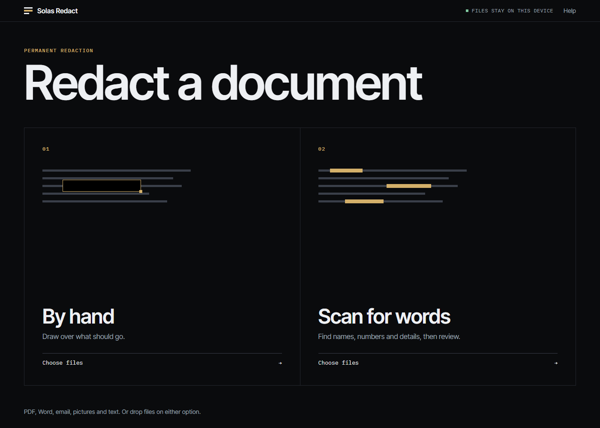
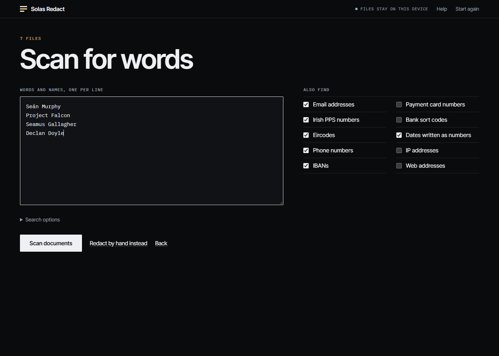
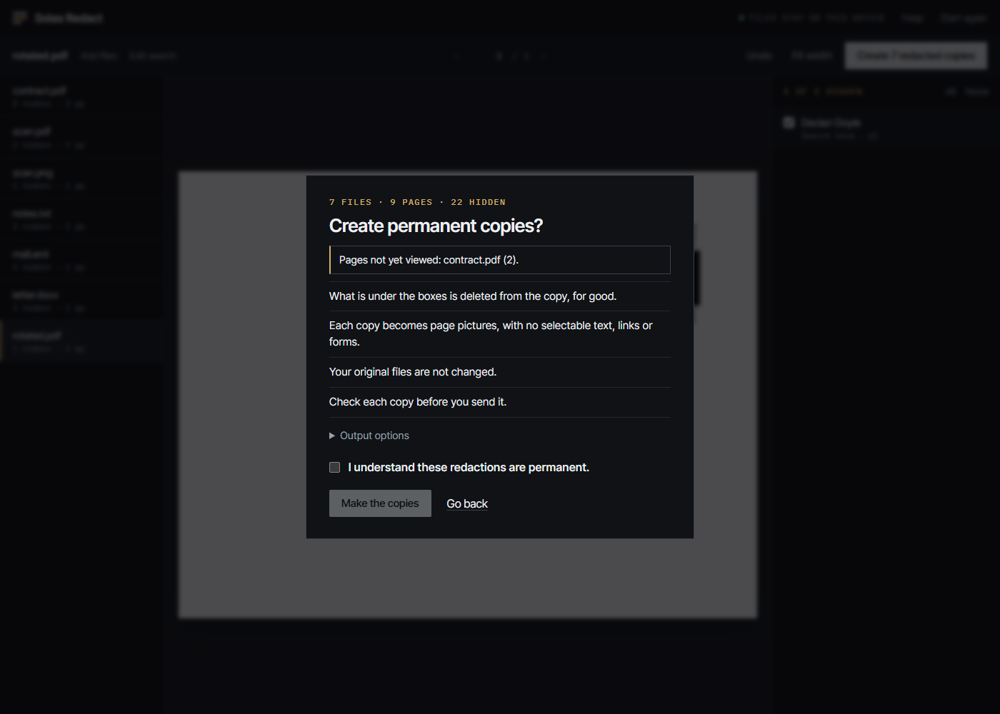
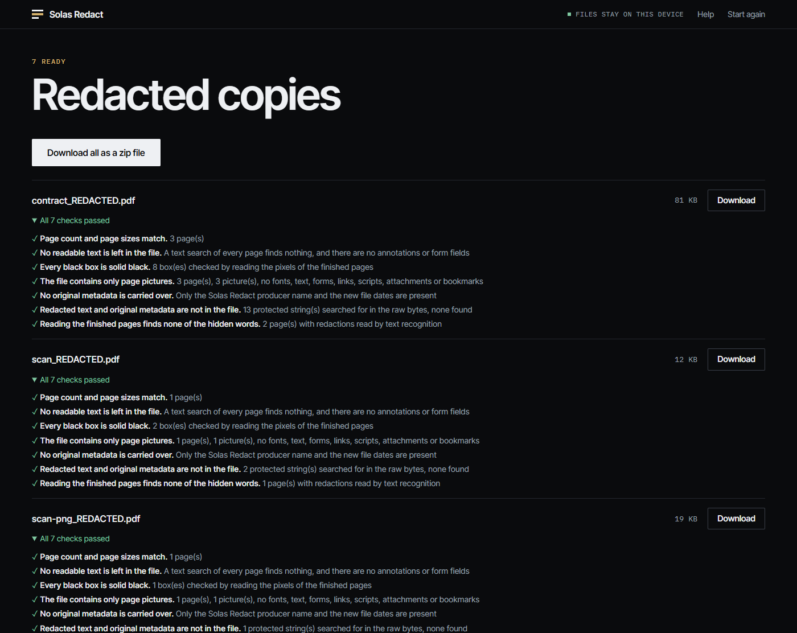

Choose how to redact, mark what should go, and make the copy. Nothing leaves your device at any point.

## Before you start

- Use a current browser. Solas Redact is tested in {{e2e-browser-list}}. See [limits](/docs/limits/).
- Keep your original files. Solas Redact never changes them, and a redacted copy cannot be turned back into the original.
- Open Solas Redact at [/app/](/app/). It works with no internet connection once it has loaded once.

## 1. Choose how to redact

The first screen has two options. Pick one, then choose files or drop them on it.

- **By hand** opens the page straight away so you can draw boxes.
- **Scan for words** asks what to find first, then shows every match for you to review.

<figure>

</figure>

You can add many files at once, of different kinds.

| File | What happens |
|---|---|
| PDF | Opened as it is. If it has a password, Solas Redact asks for it. |
| Picture (PNG, JPEG, WebP, GIF, BMP, AVIF) | Becomes one PDF page. |
| Word .docx | Converted to a plain text PDF. |
| Email .eml | Headers and readable text become a PDF page or more. |
| Text (.txt, .csv, .tsv, .log, .md) | Laid out in a fixed-width font. |

Excel, PowerPoint, Outlook .msg, older .doc, RTF and OpenDocument files are refused with an explanation. Open them in their own program and use Save as PDF. The [formats page](/docs/formats/) has the detail.

A list of your files appears only if one needs attention, for example because it needs a password or cannot be opened. Otherwise you go straight on.

## 2. Scan for words

Skip this step if you chose By hand.

- **Words and names.** One per line.
- **Also find.** Tick email addresses, Irish PPS numbers, Eircodes, phone numbers, IBANs, payment card numbers, bank sort codes, dates, IP addresses or web addresses. The [patterns page](/docs/patterns/) says what each one checks.
- **Search options.** Matching ignores upper and lower case and treats Seán and Sean as the same by default. You can change both, and choose whole words only or any text containing the term. A line written between slashes, like `/case\s?\d+/`, is used as a pattern. Text recognition is on by default: pages that are pictures, such as scans, are read so they can be searched. English only.

<figure>

</figure>

## 3. Mark what should go

The page fills the window. This is the step where you decide.

- Drag on the page to draw a box. Click a box you drew to remove it.
- **Undo** or Ctrl+Z takes back the last change.
- The left and right arrow keys turn the page. **Fit width** makes the page as wide as the window.
- After a scan, click a black box to keep that text. A kept match shows a dashed outline. The list on the right jumps to a page, or keeps or hides a match.
- Pages that are pictures with no text are marked after a scan. Look at them by eye.
- With several files, the list on the left switches between them.

<figure>

</figure>

## 4. Make the copies

Press **Create** and read the confirmation. It warns you about any file with nothing hidden and any page you have not viewed, states what is permanent, and asks you to tick that you understand.

Page quality and the final reading check are under **Output options**. Quality is colour at 150, 200 or 300 dpi, or a black and white copy that is much smaller for text pages. Read the finished pages is on by default: Solas Redact reads the finished pages again and looks for the hidden words. It is slower and it is the strongest check.

<figure>

</figure>

Each file is then built and checked. A copy that passes all its checks is offered for download. A copy that fails any check is not kept, and Solas Redact tells you which check failed.

- Download the copy. With several files, download all as one zip file or each on its own. If your browser supports it, Save to a folder appears. Files already in the folder are never replaced.
- Download the report. It lists file names, page counts, how many items each rule hid, and a SHA-256 fingerprint of each original and each copy. It never contains the hidden text.
- Copies are named like the original with `_REDACTED.pdf` added. If two files would get the same name, the second one includes its original extension, for example `scan-png_REDACTED.pdf`.

<figure>

</figure>

## Before you send a copy

Open the copy and look at it. Solas Redact checks what it can prove, but it cannot know what you consider sensitive. Search the document for the details that matter, look at every page that was a picture, and keep your originals somewhere safe. Delete downloaded copies you no longer need.

## When something goes wrong

- **A check failed.** Go back to the page. Change the boxes or the settings, then make the copy again. If the same check keeps failing, [report it](https://github.com/SOLAS33/solas-redact/issues) without attaching the document.
- **A page is too large.** Pages bigger than 40 million pixels at the chosen resolution are drawn smaller. The report says so.
- **It is slow.** Text recognition takes about a second or more per scanned page. Untick it if you do not need it. The [limits page](/docs/limits/) has measured times.
