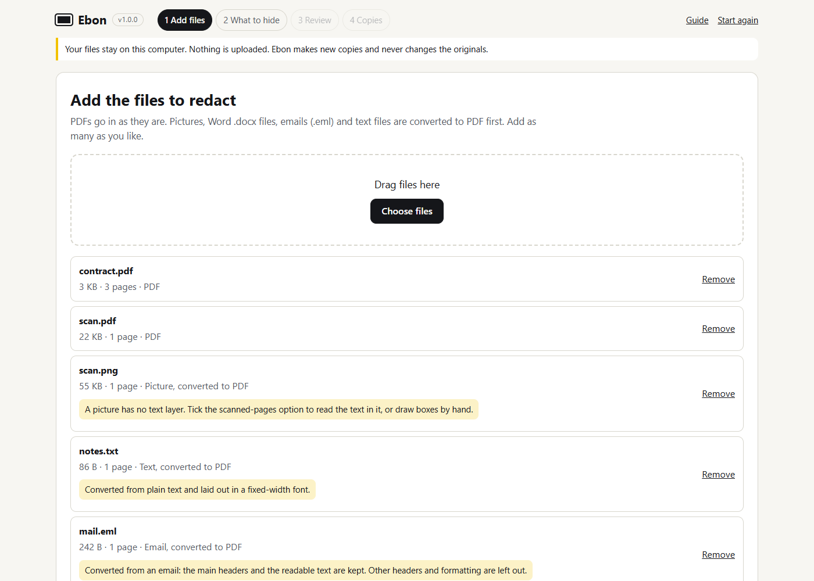
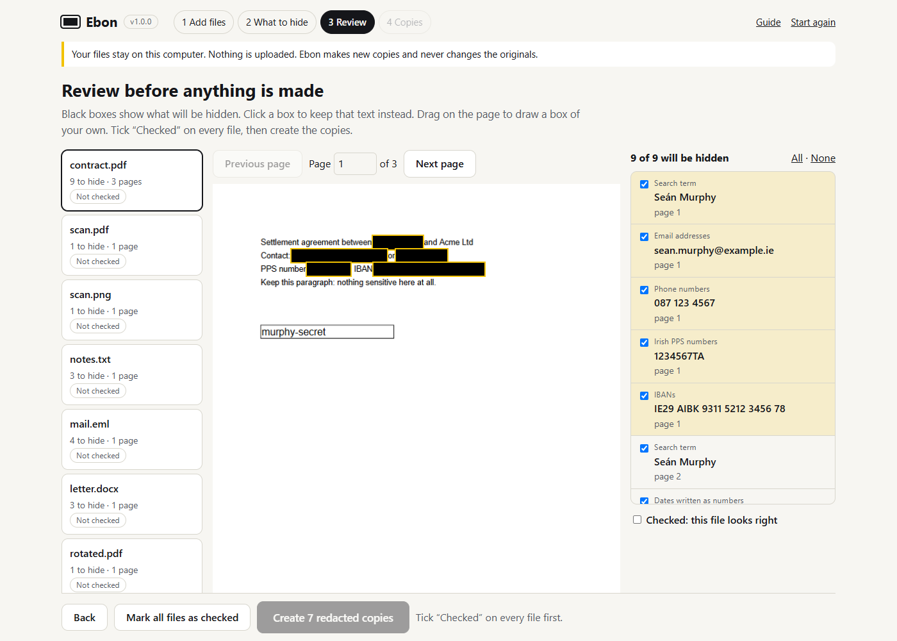

Ebon makes redacted copies of your documents in four steps. It takes a few minutes for a handful of files. Nothing leaves your computer at any point.

## Before you start

- Use a current version of Chrome. Ebon is tested there. See [limits](/docs/limits/) for other browsers.
- Keep your original files. Ebon never changes them, and a redacted copy cannot be turned back into the original.
- Open Ebon at [/app/](/app/). It works with no internet connection once it has loaded once.

## 1. Add files

Drag files onto the page or choose them. You can add many at once, of different kinds.

| File | What happens |
|---|---|
| PDF | Opened as it is. If it has a password, Ebon asks for it. |
| Picture (PNG, JPEG, WebP, GIF, BMP, AVIF) | Becomes one PDF page. |
| Word .docx | Converted to a plain text PDF. |
| Email .eml | Headers and readable text become a PDF page or more. |
| Text (.txt, .csv, .tsv, .log, .md) | Laid out in a fixed-width font. |

Excel, PowerPoint, Outlook .msg, older .doc, RTF and OpenDocument files are refused with an explanation. Open them in their own program and use Save as PDF. The [formats page](/docs/formats/) has the detail.

<figure>

</figure>

## 2. Say what to hide

- **Words and names.** One per line. Matching ignores upper and lower case and treats Seán and Sean as the same by default. You can change both, and choose whole words only or any text containing the term.
- **Patterns.** A line written between slashes, like `/case\s?\d+/`, is used as a pattern.
- **Kinds of detail.** Tick email addresses, Irish PPS numbers, Eircodes, phone numbers, IBANs, payment card numbers, bank sort codes, dates, IP addresses or web addresses. The [patterns page](/docs/patterns/) says what each one checks.
- **Page quality.** Colour copies at 150, 200 or 300 dpi, or a black and white copy that is much smaller for text pages.
- **Text recognition.** Ticked by default. Pages that are pictures, such as scans, are read so they can be searched. English only.
- **Read the finished pages.** Ticked by default. After each copy is made, Ebon reads the finished pages again and looks for the hidden words. It is slower and it is the strongest check.

You can leave everything empty and draw boxes by hand in the next step.

<figure>

</figure>

## 3. Review

Every match is shown on the page as a black box. This is the step where you decide.

- Click a box to keep that text. A kept box is outlined in red.
- Drag on the page to draw a box of your own.
- Use the list on the right to jump to a page, or to keep or hide a match.
- Pages that are pictures with no text are marked. Look at them by eye.
- A file with nothing hidden is marked "Nothing is hidden".
- Tick **Checked** on each file. Ebon will not make copies until every file is checked.

<figure>

</figure>

## 4. Make the copies

Press **Create** and read the confirmation. Ebon states what is permanent and asks you to tick that you understand.

<figure>

</figure>

Each file is then built and checked. A copy that passes all its checks is offered for download. A copy that fails any check is not kept, and Ebon tells you which check failed.

- Download each copy, or all as one zip file. If your browser supports it, a Save to a folder button appears. Files already in the folder are never replaced.
- Download the report. It lists file names, page counts, how many items each rule hid, and a SHA-256 fingerprint of each original and each copy. It never contains the hidden text.
- Copies are named like the original with `_REDACTED.pdf` added. If two files would get the same name, the second one includes its original extension, for example `scan-png_REDACTED.pdf`.

<figure>

</figure>

## Before you send a copy

Open the copy and look at it. Ebon checks what it can prove, but it cannot know what you consider sensitive. Search the document for the details that matter, look at every page that was a picture, and keep your originals somewhere safe. Delete downloaded copies you no longer need.

## When something goes wrong

- **A check failed.** Go back to the review step. Change the boxes or the settings, then make the copy again. If the same check keeps failing, [report it](https://github.com/SOLAS33/ebon/issues) without attaching the document.
- **A page is too large.** Pages bigger than 40 million pixels at the chosen resolution are drawn smaller. The report says so.
- **It is slow.** Text recognition takes about a second or more per scanned page. Untick it if you do not need it. The [limits page](/docs/limits/) has measured times.
