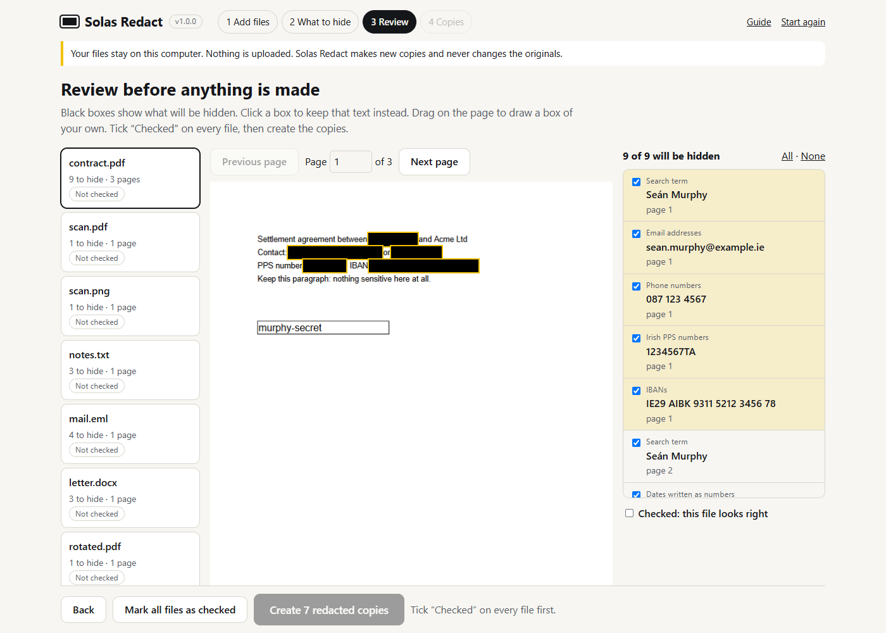

<ul class="facts">
<li><strong>No uploads</strong>The page has no server code to upload to. Its security policy only allows connections to its own address, and a test checks every request.</li>
<li><strong>Up to 7 checks per copy</strong>Solas Redact re-opens each finished file and checks it before it can be downloaded. A copy that fails is not offered.</li>
<li><strong>MIT licence</strong>Free to use, copy, change and share. No account, no licence key, no cost.</li>
<li><strong>{{e2e-passed}} browser checks</strong>The test results are published, including how each check is done.</li>
</ul>

## How it works

<ol class="steps">
<li><strong>Add files.</strong> PDFs, pictures, Word .docx files, emails (.eml) and text files. Anything that is not a PDF is converted to one first.</li>
<li><strong>Say what to hide.</strong> Type names and words, and tick details such as email addresses, Irish PPS numbers, Eircodes, IBANs and phone numbers.</li>
<li><strong>Review.</strong> Every match is shown as a black box on the page. Click a box to keep that text. Drag to draw your own.</li>
<li><strong>Make the copies.</strong> Solas Redact asks you to confirm that the redactions are permanent, then writes new files named <code>_REDACTED.pdf</code>. Your originals are never changed.</li>
</ol>

<figure>

<figcaption>The review screen. Black boxes show what will be hidden. The list on the right lets you keep or hide each match.</figcaption>
</figure>

## What is removed

Solas Redact does not draw boxes over the text in your PDF. It draws each page to a picture, paints the black boxes into the picture, and builds a new PDF from the pictures alone. The new file has no text, no fonts, no metadata, no attachments, no form fields, no comments and no links. There is nothing under the boxes to recover because the original page is not in the new file.

The [method](/docs/how-it-works/) and the [checks](/docs/verification/) are written out in full. Black boxes drawn over live text are a [well-documented cause of leaks](/docs/research/).

## What it does not do

- The copy is made of page pictures. You cannot search or copy text in it, so it does not suit filings that must be text-searchable.
- It finds text in the PDF's own text layer, and in pictures of pages with English text recognition. Text recognition can misread. You review every match.
- Word files are converted as plain text. Layout and images are not kept. Excel, PowerPoint, Outlook .msg and older .doc files must be saved as PDF first.
- It has been tested in Chrome on Windows. Other browsers are untested.

The full list is on the [limits page](/docs/limits/).

## Free, and what free means

Solas Redact is released under the MIT licence. You can use it at work, copy it, change it and give it to others, with no payment. The code and its test suite are public. It costs nothing to run: the site is static files, and the tool does its work on your own computer. See the [licence page](/docs/licence/) for every component and its terms.

<a class="btn primary" href="/app/">Open Solas Redact</a> <a class="btn" href="/docs/self-hosting/">Run your own copy</a>

